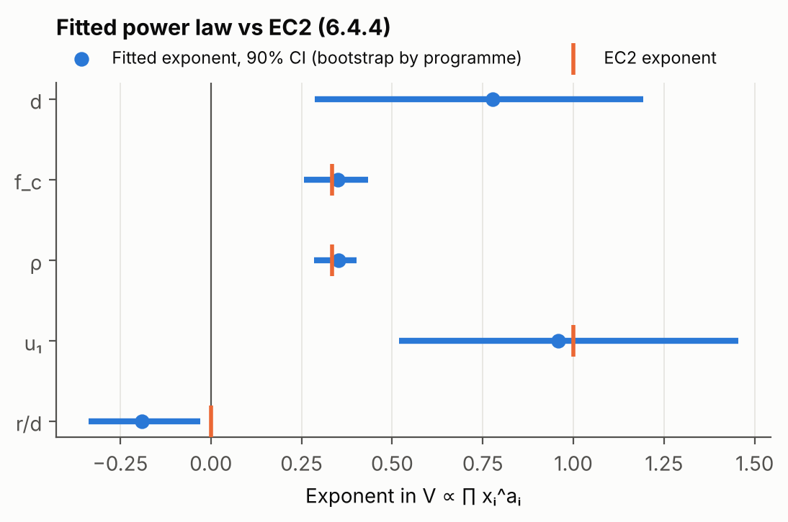
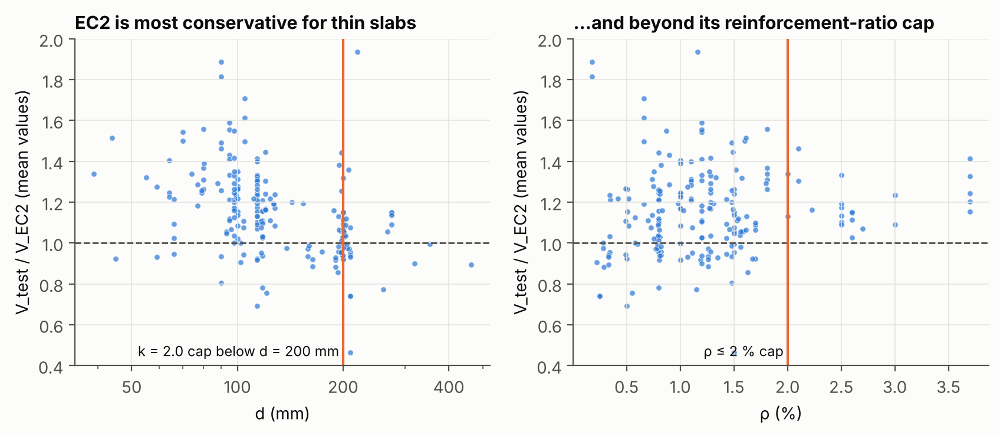
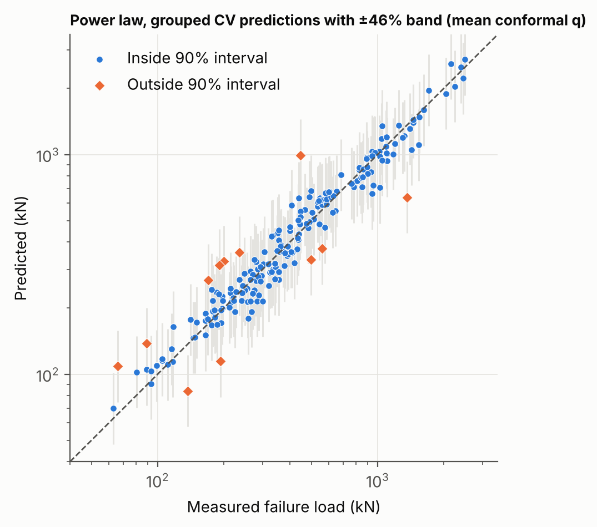

# Punching shear of RC flat slabs: does machine learning beat Eurocode 2 on unseen test programmes?

[](https://github.com/hildalakzaei7-pixel/punching-shear-ml/actions)


Punching at slab–column connections is brittle, and it governs the design of many flat slabs.
Test databases are a natural target for machine learning, but their tests come in series: one
laboratory programme changes one or two parameters across specimens that are otherwise identical.
A random train/test split therefore puts near-twins on both sides and measures how well a model
interpolates *within* programmes.

This project asks the question that matters in practice:

> **How well does each model predict a test programme it has never seen?**

| | |
|---|---|
| **Data** | 205 interior slab–column tests without shear reinforcement, from 38 test programmes (TU Dortmund database, audited) |
| **Baseline** | EN 1992-1-1:2004, 6.4.4, with mean material values and nothing fitted |
| **Validation** | 5-fold cross-validation grouped by test programme, 5 repeats, nested tuning |
| **Main result** | On unseen programmes no model has less scatter than the EC2 expression (CoV ≈ 0.18–0.19). Tree models trained on force are clearly worse, which random splits hide |

---

## 1. Data

The source is the open database by Spyridis, Mellios, Uz and Walter (2023): 543 full-scale tests from
54 publications. It is protected by original copyright, so **it is not redistributed here**; see
[`data/README.md`](data/README.md) for the download and the checksum the code verifies.

Cleaning (full rationale in [`data/DATA_DICTIONARY.md`](data/DATA_DICTIONARY.md)):

* kept interior connections without shear reinforcement and without fibres;
* removed tests reported as flexural failures;
* **removed 44 rows after reading every reference title**, because the sheet's columns describe them as
  plain slabs when they are not: CFRP-strengthened specimens (Sissakis & Sheikh 2007; Binici & Bayrak
  2003), footing tests (Siburg 2014, DF series) and lightweight-aggregate concrete (Theodorakopoulos &
  Swamy 1989). The rules are listed in `src/punching_ml/data.py` (`MANUAL_EXCLUSIONS`);
* kept tests whose failure mode is not reported (they include classic punching series), flagged, and
  re-ran the key comparison without them (section 6);
* left out the steel yield strength as an input (21 % missing; the EC2 expression does not use it).

| Input | Range in the core set |
|---|---|
| effective depth *d* | 39–464 mm |
| column size *b* (square side or circle diameter) | 54–520 mm |
| concrete strength *f*<sub>c</sub> (mean cylinder) | 13–119 MPa |
| flexural reinforcement ratio ρ | 0.2–3.7 % |
| load radius *r* (span proxy) | 325–2580 mm |
| failure load | 63–2491 kN |


## 2. Models

| Model | Idea | Fitted parameters |
|---|---|---|
| **EC2 (mean values)** | *v* = 0.18 *k* (100 ρ *f*<sub>c</sub>)<sup>1/3</sup> ≥ *v*<sub>min</sub>, *V* = *v u*<sub>1</sub> *d*, *k* ≤ 2, ρ ≤ 2 % | none |
| EC2 (C refitted) | same form, constant 0.18 refitted | 1 |
| **Power law** | ln *V* linear in ln *d*, ln *f*<sub>c</sub>, ln ρ, ln *u*<sub>1</sub>, ln(*r*/*d*) | 6 |
| Random forest, XGBoost | trees on raw inputs + dimensionless groups, target ln *V* | many |
| XGBoost (stress target) | trees on the nominal stress *V* / (*u*<sub>1</sub> *d*) | many |
| **EC2 + XGBoost correction** | *V* = *V*<sub>EC2</sub> · exp(*f*(x)); trees learn only the code's error | many |

Everything except the EC2 baseline is trained in log space, because test scatter grows with capacity.
Engineering accuracy is reported as the ratio *V*<sub>test</sub>/*V*<sub>pred</sub>: its mean (bias),
its coefficient of variation (scatter), and the share of tests with a ratio below 1 (prediction above
the measured failure load).

## 3. Main result


| Model | R², random | R², grouped | CoV of ratio, grouped | Mean ratio, grouped |
|---|---:|---:|---:|---:|
| **EC2 (mean values)** | 0.943 | **0.943** | **0.183** | 1.15 |
| EC2 (C refitted) | 0.934 | 0.932 | 0.186 | 1.02 |
| **Power law** | 0.954 | **0.944** | 0.186 | 1.01 |
| EC2 + XGBoost correction | 0.958 | 0.929 | 0.188 | 1.02 |
| XGBoost (stress target) | 0.941 | 0.879 | 0.208 | 1.04 |
| XGBoost | 0.909 | 0.779 | 0.243 | 1.09 |
| Random forest | 0.868 | 0.745 | 0.280 | 1.08 |

*Mean of 5 repeats × 5 folds. EC2 has no fitted parameters, so both protocols give the same numbers.
With hyper-parameters tuned inside each outer fold only (nested), the EC2 + XGBoost correction reaches
CoV 0.181 ± 0.011, the same as EC2.*

What this shows:

1. **Random cross-validation flatters the flexible models.** Under random folds the EC2 + XGBoost
   correction has the lowest scatter of all (CoV 0.152). On unseen programmes that advantage disappears.
   Plain XGBoost drops from R² 0.91 to 0.78.
2. **Tree models trained on force do not extrapolate in size.** The three thickest slabs (*d* ≥ 300 mm)
   are under-predicted by a factor of 1.7 on average (up to 2.1) when their programme is held out.
   With only three such tests this is an illustration of the mechanism, not a measured error rate.

   

3. **Normalising the target helps but does not close the gap.** Training on nominal stress lifts R² to
   0.88, still below the code.
4. **On new programmes, no model here has less scatter than the EC2 expression.** The fitted models
   remove EC2's conservative bias (mean ratio 1.15 → about 1.02); none reduces the scatter below
   CoV ≈ 0.18.

## 4. What the data say about the EC2 expression

The power law is refitted on 500 bootstrap resamples of *whole programmes*:



* The fitted exponents of *f*<sub>c</sub> (0.36, 90 % CI 0.26–0.43) and ρ (0.34, CI 0.29–0.40) agree
  with the 1/3 used in EC2.
* Slenderness *r*/*d*, absent from the EC2 expression, has a small negative exponent (−0.18, CI −0.34
  to −0.03) once the other variables are held fixed. The interval only just excludes zero.
* The *d* and *u*<sub>1</sub> exponents are poorly identified (wide intervals): depth and perimeter
  are strongly correlated in the tests.

The residuals of EC2 line up with its own caps:



* **Thin slabs.** For *d* < 200 mm, where *k* is capped at 2.0, the mean ratio is 1.18 (160 tests); for
  *d* ≥ 200 mm it is 1.03 (45 tests).
* **Heavy reinforcement.** Above the ρ ≤ 2 % cap the mean ratio is 1.20 (21 tests).

The SHAP analysis of the EC2-correction model points the same way: depth, load radius, slenderness
and ρ are the inputs on which the code's error depends most.


## 5. Uncertainty on unseen programmes

Split conformal prediction (Papadopoulos et al., 2002; Lei et al., 2018), applied on the log scale
with training, calibration and test sets disjoint **by programme**, over 30 random group splits:

| Model | Mean coverage (target 90 %) | Interval |
|---|---:|---|
| EC2 (C refitted) | 91.6 % ± 8.4 | *V̂* ÷ 1.49 to *V̂* × 1.49 |
| Power law | 89.0 % ± 10.4 | *V̂* ÷ 1.47 to *V̂* × 1.47 |
| EC2 + XGBoost correction | 91.7 % ± 7.2 | *V̂* ÷ 1.49 to *V̂* × 1.49 |

A factor of about 1.5 either way is the honest width for a 90 % interval on a new test programme.
Coverage varies a lot between splits because whole programmes move in and out of the calibration set.



## 6. Sensitivity

Restricted to the 118 tests (25 programmes) whose failure mode is reported as punching, the
conclusions hold. Grouped CoV is 0.190 for EC2, 0.180 for the power law and 0.182 for the EC2 + XGBoost
correction; EC2's mean ratio is 1.18.

## 7. Limitations

* One database, one test type: concentric loading, interior columns, no shear reinforcement.
  Edge and corner columns, moment transfer, shear reinforcement and fibres are not covered.
* EC2 is evaluated with mean values and γ<sub>c</sub> = 1. This is a comparison of models with tests,
  **not a design check**, and the ratios say nothing about the safety of the code with its partial factors.
* Ten tests have *f*<sub>c</sub> above 90 MPa, beyond the strength classes covered by EN 1992-1-1.
* Only one flexural ratio is given per test (the second direction is empty in the database), so ρ is
  used directly rather than as the geometric mean of two directions.
* Circular columns: the database gives the same equivalent diameter formula (*b*′ = 1.128 *b*) for
  square and circular columns. The code takes *b* as the diameter of circular columns; this
  interpretation could not be checked against the original publications.
* The manual exclusions rest on reference titles and specimen names; the original papers were not
  re-read for every test.
* 38 programmes is a small number of independent groups; the spread across repeats is reported for that reason.
* No external validation yet. The fib / ACI 445 punching database is the natural next test set.

## Reproduce

```bash
git clone https://github.com/hildalakzaei7-pixel/punching-shear-ml.git
cd punching-shear-ml
python -m venv .venv && source .venv/bin/activate      # Windows: .venv\Scripts\activate
pip install -e ".[dev]"
# download the workbook into data/raw/ (see data/README.md), then:
pytest -q                          # 9 tests; the last one checks the real file if present
python -m punching_ml.pipeline     # about 3 minutes; writes results/
```

```
src/punching_ml/
├── data.py       parsing, programme IDs, cleaning rules and manual exclusions, checksum
├── ec2.py        EN 1992-1-1 6.4.4 with mean values
├── models.py     power law, EC2 correction, tree models
├── evaluate.py   random vs grouped CV, nested tuning, ratio metrics, grouped conformal
├── plots.py      figure style
└── pipeline.py   full experiment → results/
```

## References

1. Spyridis, P., Mellios, N., Uz, O., & Walter, L. (2023). *Database of experimental results from punching
   shear tests with various types of reinforcement* [Dataset]. TU Dortmund. https://doi.org/10.17877/DE290R-23085
2. Mellios, N., Uz, O., & Spyridis, P. (2023). Data-based modeling of the punching shear capacity of concrete
   structures. *Engineering Structures*, 275, 115195.
3. CEN (2004). *EN 1992-1-1: Eurocode 2: Design of concrete structures. Part 1-1: General rules and rules
   for buildings*, clause 6.4.4.
4. Chen, T., & Guestrin, C. (2016). XGBoost: A scalable tree boosting system. *Proc. 22nd ACM SIGKDD*,
   785–794. https://doi.org/10.1145/2939672.2939785
5. Lundberg, S. M., & Lee, S.-I. (2017). A unified approach to interpreting model predictions.
   *Advances in Neural Information Processing Systems 30*, 4765–4774. https://arxiv.org/abs/1705.07874
6. Papadopoulos, H., Proedrou, K., Vovk, V., & Gammerman, A. (2002). Inductive confidence machines for
   regression. *Machine Learning: ECML 2002*, LNCS 2430, 345–356. https://doi.org/10.1007/3-540-36755-1_29
7. Lei, J., G'Sell, M., Rinaldo, A., Tibshirani, R. J., & Wasserman, L. (2018). Distribution-free predictive
   inference for regression. *JASA*, 113(523), 1094–1111. https://doi.org/10.1080/01621459.2017.1307116

## Author

**Hilda Lakzaei**, Civil Engineering (Structural), Sharif University of Technology.
Related: [concrete-strength-ml](https://github.com/hildalakzaei7-pixel/concrete-strength-ml), which uses the same grouped-validation approach.
[LinkedIn](https://www.linkedin.com/in/hilda-lakzaei-32a4a8341) · [Website](https://hilda-lakzaei.netlify.app/)
